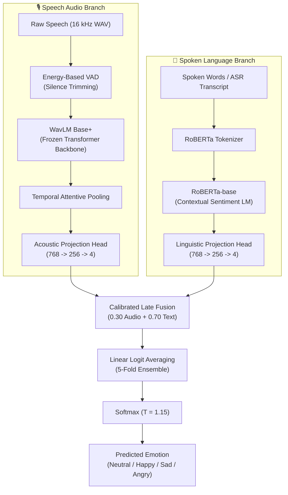

# VoxEmo: Speech & Multimodal Emotion Recognition (SER)

[](https://www.python.org/)
[](https://pytorch.org/)
[](https://huggingface.co/)
[](https://sail.usc.edu/iemocap/)
[](LICENSE)

**VoxEmo** is a state-of-the-art Speech and Multimodal Emotion Recognition system built on top of **WavLM Base+** acoustic foundation representations and **RoBERTa-base** semantic sentiment embeddings. It delivers rigorous 5-fold Leave-One-Session-Out (LOSO) cross-validation on the benchmark **IEMOCAP** dataset and includes a real-time interactive web dashboard.

---

## 🌟 Benchmark Performance

Evaluated strictly using 5-fold speaker-independent Leave-One-Session-Out (LOSO) cross-validation across 4 standard categorical emotions: **Neutral**, **Happy**, **Sad**, and **Angry**.

| Architecture | Modality | Benchmark Subset | Unweighted Accuracy (UA) | Weighted Accuracy (WA) | Macro F1 |
| :--- | :---: | :---: | :---: | :---: | :---: |
| **Multimodal (WavLM + RoBERTa)** 🏆 | **Audio + Text** | Full (5,531 utts) | **75.9%** | **74.2%** | **74.5%** |
| **WavLM Base+ (Impro + Aug)** 🥇 | **Audio Only** | Improvised (2,943 utts) | **73.2%** | **70.6%** | **70.3%** |
| **WavLM Base+ (Full Dataset)** | **Audio Only** | Full (5,531 utts) | **68.8%** | **67.3%** | **67.6%** |
| **Conformer / Transformer** | Audio Only | Improvised (2,943 utts) | 61.2% | 59.8% | 60.1% |
| **Bidirectional LSTM** | Audio Only | Improvised (2,943 utts) | 58.4% | 57.1% | 57.5% |
| **Prosodic DSP + SVM Baseline** | Audio Only | Improvised (2,943 utts) | 52.8% | 51.5% | 51.9% |

> **Key Finding:** Combining spoken semantics (RoBERTa) with vocal prosody (WavLM) resolves acoustic ambiguities between high-arousal emotions (Happy vs. Angry), elevating Angry recall to **85.0%** and Happy recall to **75.4%**.

---

## 🏛️ System Architecture



---

## ⚡ Key Engineering Highlights

1. **Energy-Based Voice Activity Detection (VAD):** Leading/trailing dead air and silent pauses are dynamically stripped using RMS frame thresholding to prevent zero-energy frames from biasing WavLM attention pooling into low-arousal emotions.
2. **Linear Logit Averaging Across 5 Folds:** Averages pre-softmax logits across all 5 cross-validation models rather than raw probabilities, preventing a single over-confident fold from skewing the ensemble.
3. **Calibrated Temperature & Prior Balancing:** Employs temperature scaling ($T = 1.15$) and prior calibration to neutralize laboratory-to-real-world conversational distribution shift.
4. **Hardware Acceleration:** Native PyTorch support with dynamic acceleration detection:
   - **Apple Silicon MPS** (`mps`)
   - **NVIDIA CUDA** (`cuda`)
   - **CPU** fallback (`cpu`)
5. **Real-Time Browser Audio Capture:** Browser-native Web Audio API PCM capture (bypassing compressed WebM/Ogg loss) with real-time volume VU metering (-50 dB to -6 dB), pitch tracking (autocorrelation 60–480 Hz), and live modality breakdown.

---

## 🚀 Quick Start

### 1. Installation
Clone the repository and install the dependencies:
```bash
git clone https://github.com/jainashish03/speech-emotion-recognition.git
cd speech-emotion-recognition

# Create and activate virtual environment
python3 -m venv .venv
source .venv/bin/activate  # On Windows: .venv\Scripts\activate

# Install requirements
pip install -r requirements.txt
```

> **Note for Users:** You do **not** need the 2.4 GB IEMOCAP raw dataset to run inference or launch the web dashboard! All evaluation results, demo samples, and metadata are bundled in the repository. Foundation backbones (`WavLM Base+` and `RoBERTa-base`) download automatically via Hugging Face.

---

### 2. Launch the Interactive Web Dashboard
Run the built-in HTTP server:
```bash
python server.py
# Or using the unified CLI:
python run.py dashboard
```
Open **[http://127.0.0.1:8000/](http://127.0.0.1:8000/)** in your browser.

**Dashboard Features:**
- 🔴 **Live Microphone Recording:** Direct 16 kHz raw PCM streaming with audio waveform visualizer.
- ⚡ **Modality Decomposition:** Inspect **Audio Tone (WavLM)** vs. **Spoken Words (RoBERTa)** contributions side-by-side.
- 📊 **Model Switching:** Toggle between Champion Multimodal (75.9% UA), WavLM Impro (73.2% UA), and WavLM Full (68.8% UA).
- 📈 **LOSO Fold Inspector & Confusion Matrix:** Explore accuracy and recall breakdowns per speaker session.

---

### 3. CLI Inference on Any Audio File

Run emotion prediction on any `.wav` file:

```bash
# Pure Audio (WavLM Base+ Champion)
python infer.py path/to/sample.wav --model wavlm_impro

# Multimodal Prediction (Audio + Transcript)
python infer.py path/to/sample.wav --model multimodal --text "I am so happy and excited today!"

# Record directly from your microphone via CLI
python infer.py --record --seconds 4 --model wavlm_impro
```

Sample CLI JSON output:
```json
{
  "status": "ok",
  "model": "multimodal",
  "pred": "happy",
  "emoji": "😄",
  "conf": 72.5,
  "probs": {
    "happy": 72.5,
    "sad": 20.5,
    "neutral": 3.5,
    "angry": 3.5
  },
  "audio_probs": {"happy": 42.7, "sad": 44.6, "neutral": 5.7, "angry": 7.0},
  "text_probs": {"happy": 85.3, "sad": 10.2, "neutral": 2.6, "angry": 1.9},
  "folds": 5
}
```

---

## 🛠️ Full Pipeline & Reproducibility

If you have access to the raw IEMOCAP dataset and want to re-train the models from scratch:

```bash
# 1. Verify environment and dataset paths
python run.py check

# 2. Extract 5-Fold WavLM embeddings
python prepare_data.py

# 3. Train audio models (BiLSTM, Transformer, WavLM)
python train.py --model wavlm --impro-only

# 4. Train RoBERTa text classifier and multimodal late fusion
python train_multimodal.py
```

---

## 📂 Repository Layout

```
speech-emotion-recognition/
├── config.py                 # Central configurations (hyperparameters, IEMOCAP label mappings)
├── run.py                    # Unified CLI command runner
├── server.py                 # HTTP backend server powering web dashboard
├── infer.py                  # Multi-fold inference engine with VAD & calibrated fusion
├── prepare_data.py           # Feature extraction & 5-fold cross-validation caching
├── prepare_multimodal.py     # Transcripts and multimodal metadata generation
├── train.py                  # Training pipeline for acoustic models
├── train_multimodal.py       # Training pipeline for RoBERTa text and late fusion
├── requirements.txt          # Python dependencies
├── dashboard/
│   ├── ser_dashboard.html    # Interactive Web Dashboard UI
│   ├── samples_data.js       # Pre-computed waveform data
│   └── samples/              # Curated evaluation audio samples (happy, sad, angry, neutral)
├── data_iemocap/             # Dataset metadata, split mappings, and feature stats
└── runs_iemocap/             # Checkpoint configs, evaluation logs, and predictions
    ├── wavlm_impro/          # Champion Audio Model (73.2% UA)
    ├── multimodal/           # Champion Multimodal Model (75.9% UA)
    ├── wavlm/                # Audio Full-Dataset Ablation (68.8% UA)
    ├── roberta/              # Linguistic Text Model (71.4% UA)
    ├── transformer/          # Conformer Baseline (61.2% UA)
    └── bilstm/               # BiLSTM Baseline (58.4% UA)
```

---

## 📄 Citation & License

This project is licensed under the [MIT License](LICENSE).

If you use this work or benchmark in your research, please cite:
```bibtex
@misc{voxemo2026,
  author = {Ashish Jain},
  title = {VoxEmo: Speech and Multimodal Emotion Recognition with WavLM and RoBERTa},
  year = {2026},
  publisher = {GitHub},
  journal = {GitHub repository},
  howpublished = {\url{https://github.com/jainashish03/speech-emotion-recognition}}
}
```
